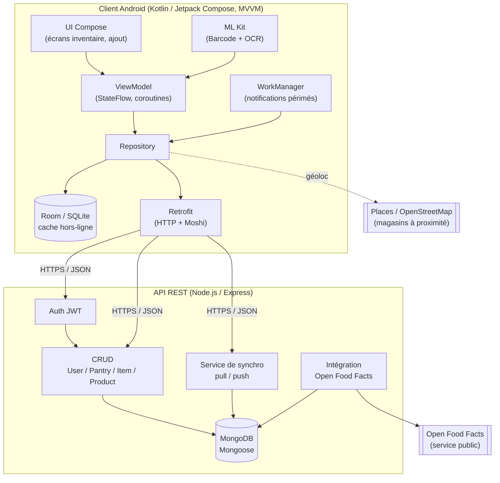
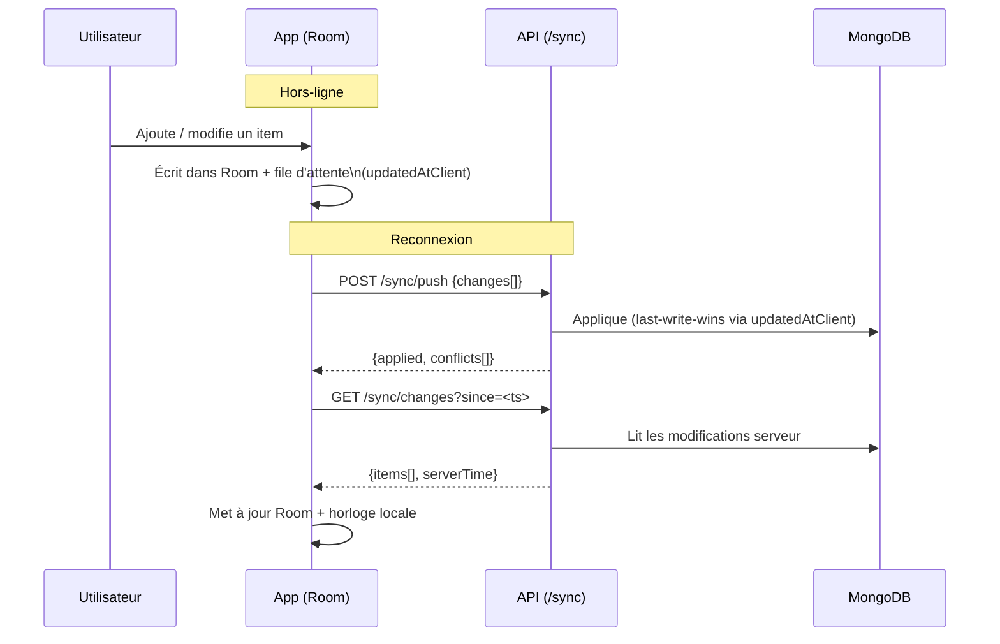

# Architecture technique — GardeManger

Système distribué à 3 tiers : **client Android** ↔ **API REST** ↔ **MongoDB**,
l'API s'appuyant sur des **services Web externes** (Open Food Facts, cartes).

## Vue en couches

## Flux de synchronisation hors-ligne (pull / push)

L'inventaire reste consultable et modifiable sans réseau ; les changements sont
réconciliés à la reconnexion.

## Choix techniques

| Décision | Raison |
| --- | --- |
| **MongoDB (NoSQL)** | Documents flexibles (produits OFF hétérogènes), itération rapide. |
| **JWT stateless** | Pas de session serveur → l'API scale et reste simple. |
| **Product séparé d'Item** | Référentiel partagé mis en cache ; on ne duplique pas les données OFF. |
| **Room comme source locale** | L'UI lit toujours Room (réactif), le réseau alimente Room en tâche de fond. |
| **Contrat OpenAPI figé** | Back et Android avancent en parallèle contre le même contrat. |

## Les 8 illusions de l'informatique distribuée (traitées)

| Illusion | Traitement dans GardeManger |
| --- | --- |
| Le réseau est fiable | File de synchro + retries ; mode hors-ligne via Room. |
| La latence est nulle | UI optimiste sur Room ; appels réseau asynchrones (coroutines). |
| La bande passante est infinie | Pagination/filtres sur l'inventaire ; images mises en cache. |
| Le réseau est sûr | Auth JWT, HTTPS en production, validation des entrées. |
| La topologie ne change pas | Reconnexion gérée ; `BASE_URL` configurable. |
| Il y a un seul administrateur | Garde-manger partagé avec owner + members. |
| Le coût de transport est nul | Synchro incrémentale (`since`) plutôt que tout retélécharger. |
| Le réseau est homogène | JSON + REST standard, indépendant du client. |

> Ce tableau alimentera directement la section « illusions » du rapport final.
