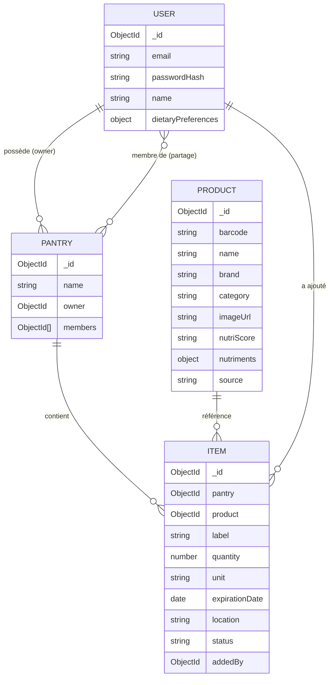

# Modèle de données — GardeManger

Base **MongoDB** (Mongoose). Quatre entités. Les schémas font foi : `backend/src/models/`.

## Diagramme (entités / relations)

## Entités

### User
Compte utilisateur. `dietaryPreferences` (restrictions + allergènes) sert à **filtrer et prioriser
les suggestions** de consommation.

### Pantry (garde-manger)
Un garde-manger appartient à un `owner` et peut être **partagé** avec d'autres `members`
(colocation / famille). C'est l'unité de synchronisation entre appareils.

### Product (catalogue)
Référentiel **partagé** de produits, identifié par `barcode`. Alimenté principalement par
**Open Food Facts** (`source: openfoodfacts`) ou créé à la main (`source: manuel`).
Un même produit peut être présent dans de nombreux `Item`.

### Item (ligne d'inventaire)
Une **instance concrète** d'un produit dans un garde-manger : « j'ai 2 de ça, qui périme le X,
dans le frigo ».
- `location` ∈ `frigo | congelateur | armoire | autre`
- `status` ∈ `actif | consomme | perime | jete`
- `expirationDate` : base des alertes (WorkManager) et des suggestions.
- `product` peut être `null` (saisie manuelle sans code-barres) → `label` prend le relais.

## Pourquoi ce découpage
- **Product séparé de Item** : on ne duplique pas les données Open Food Facts à chaque ajout ;
  on référence un produit partagé et on cache les appels externes.
- **Pantry comme racine de synchro** : le mode hors-ligne (Room) et la synchro pull/push
  travaillent par garde-manger.
